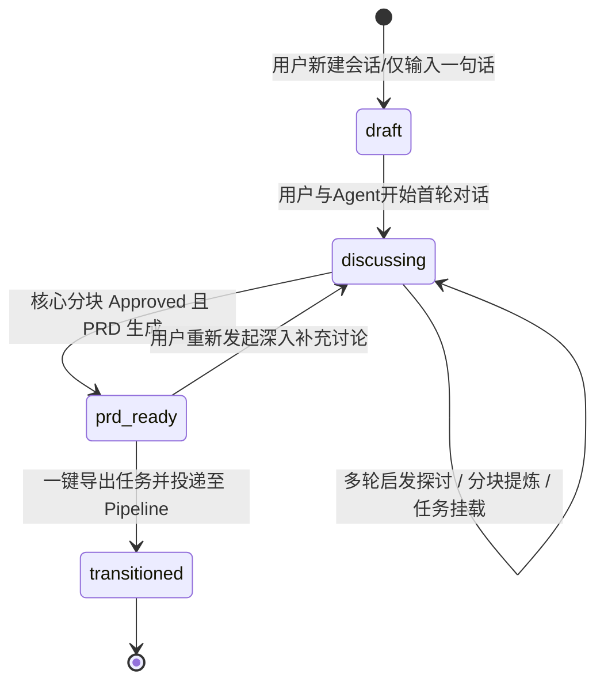
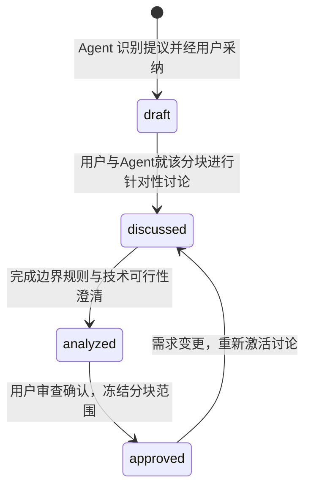
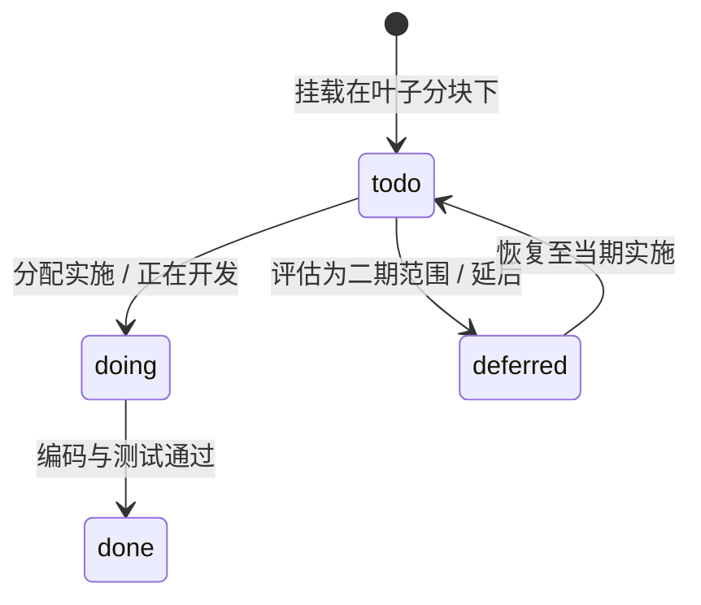
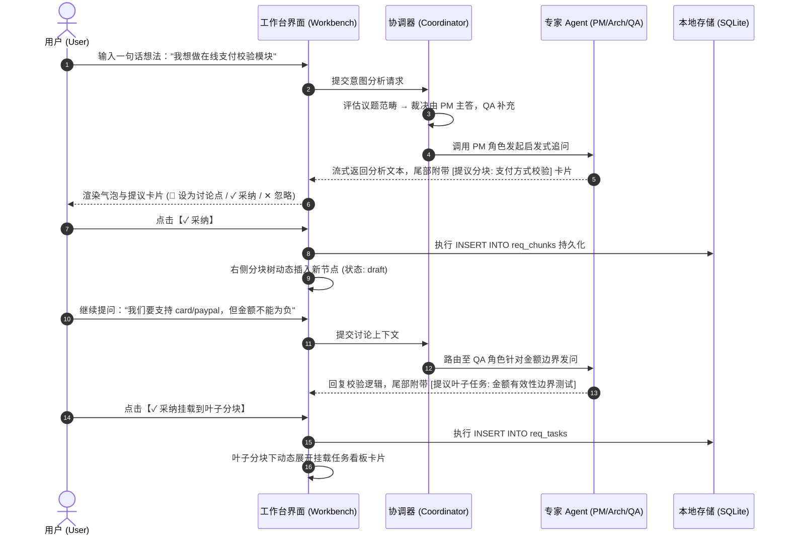
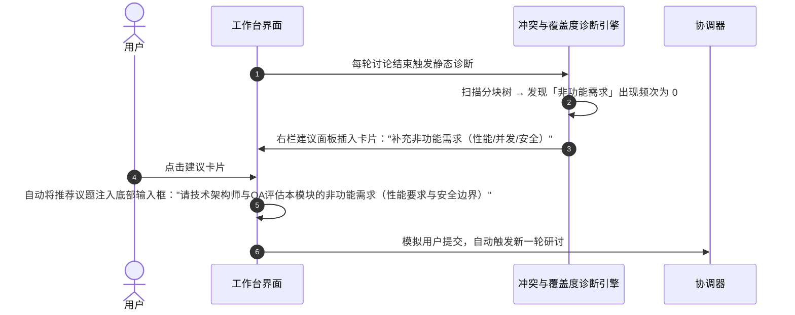
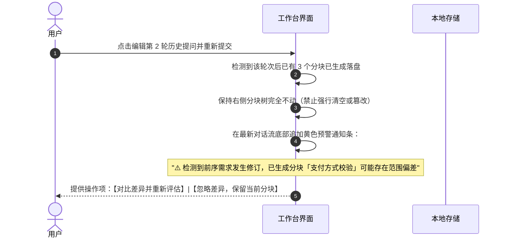

# MOD-17 / MOD-13 需求探索与分块管理详细需求规格说明书 (全面细化版)

> 文档标识：`docs/阶段-1-需求/MOD-17-需求探索与分块管理规格说明书.md`  
> 所属阶段：阶段-1-需求（客户端发源能力）  
> 版本：v2.0-Detailed  
> 状态：正式归档  
> 关联主文档：`docs/阶段-1-需求/功能模块需求规格说明书.md` (MOD-13 章节)、`docs/superpowers/specs/2026-10-28-requirements-explorer-design.md`、`docs/superpowers/specs/2026-10-28-client-server-boundary.md`  
> 运行原型：`docs/阶段-1-需求/prototype/run-requirements.html`、`docs/阶段-1-需求/prototype/run-requirements-workbench.html`

---

## 1. 业务目标与运行边界

### 1.1 业务核心定位
MOD-17 定位为 PG Harness 客户端的**上游发源地**，专门解决软件工程中最棘手的**「想法发散、边界模糊、任务脱节」**三大难题。
它通过将非结构化的自然语言研讨，与结构化的树形工程分块进行实时双向映射，实现**「边聊边结构化、分块出任务、PRD 自动成型、一键导入流水线」**的连续生产力。

### 1.2 客户端纯前端运行边界
根据《客户端与服务端职责边界规范》（`2026-10-28-client-server-boundary.md`）：
1. **纯单机客户端存储**：需求探索的所有会话数据、分块树、任务清单与建议记录，仅持久化于本地 SQLite / 客户端本地存储；数据表均无需 `owner_id`；
2. **零服务端鉴权侵入**：不依赖企业级 SSO 鉴权与服务端审批流，无需网络连接企业后台即可完整使用；
3. **模型直连能力**：调用系统已配置的全局 Provider 资产池（如 DeepSeek、OpenAI、Anthropic、本地 Ollama）直接发起多 Agent 研讨。

---

## 2. 核心状态机与生命周期流转

### 2.1 探索项目会话生命周期


- **草稿态 (draft)**：创建了项目但尚未展开实质性研讨；
- **讨论中 (discussing)**：多 Agent 介入，持续产生对话、分块与任务提炼卡片；
- **PRD 就绪 (prd_ready)**：需求分块大多批准冻结，已生成标准 PRD 文档；
- **已流转 (transitioned)**：任务包已成功投递至角色流水线或会话工作台进入编码实施。

---

### 2.2 需求分块状态机 (Chunk State Machine)


- **`draft` (草稿)**：刚从对话中识别并确认落盘，仅有初步标题与范围概要；
- **`discussed` (已讨论)**：至少经历 1 轮针对性讨论，已明确业务范围与排除项；
- **`analyzed` (已分析)**：已补充非功能需求、安全合规要求与关联代码文件边界；
- **`approved` (已批准/冻结)**：用户正式核准，不可随意变更，具备流转实施资格。

---

### 2.3 叶子任务状态机 (Task State Machine)


- **`todo` (待办)**：待实施的原子工程任务；
- **`doing` (进行中)**：已投递至流水线并由编码 Agent 正在处理；
- **`done` (已完成)**：代码已提交且自动化验证通过；
- **`deferred` (延后)**：经讨论确认为后续期次实现，从当期执行序列中剥离。

---

## 3. 多 Agent 协调器 (Coordinator) 调度架构与 Prompt 规范

### 3.1 调度架构原则
- **动态仲裁**：所有用户输入首先流经 Coordinator，由 Coordinator 基于上下文分析当前最迫切需要解答的视角；
- **发言人数约束**：单次回合仅唤醒 1~2 个最相关的 Agent 发言，杜绝 3 个以上 Agent 同时刷屏；
- **强行点名机制**：若用户输入中显式包含 `@角色名`，Coordinator 必须将该角色作为主答复者。

### 3.2 角色定位矩阵
| 角色标识 | 角色名称 | 核心职责 | 触发关键词/议题范畴 |
|---|---|---|---|
| `agent_pm` | 产品分析师 (PM) | 梳理用户痛点、业务流程、功能边界、排除项与交互预期 | 需求、场景、用户、流程、边界、为什么要做 |
| `agent_arch` | 技术架构师 (Architect) | 评估技术选型、存储模型、接口契约、并发性能、依赖包 | 数据库、API、性能、架构、第三方库、存储、延迟 |
| `agent_qa` | 质检与安全专家 (QA/Security) | 提出异常分支、边界用例、幂等重试、权限防越权与安全审计 | 测试、校验、报错、重试、安全、鉴权、漏洞、异常 |

### 3.3 Coordinator 决策与调度算法 (伪代码与 Prompt 模板)
```typescript
interface CoordinatorDecision {
  primary_agent_id: string;      // 主答复角色
  secondary_agent_id?: string;    // 协作者角色（可选）
  discussion_topic: string;       // 本次回合聚焦点
  detected_actions: {             // 自动侦测的潜在提议
    suggest_new_chunk?: { title: string; parent_id?: string; description: string; priority: 'P0'|'P1'|'P2' };
    suggest_new_task?: { chunk_id: string; title: string; acceptance_criteria: string; priority: 'P0'|'P1' };
  };
}
```

**系统引导 Prompt 规约 (Coordinator System Instruction)**：
```text
你是一个精益软件工程的多角色研讨协调者。你的任务是引导用户将模糊需求逐步结构化：
1. 观察当前对话历史与右侧已有的需求分块树；
2. 如果用户刚刚抛出一个新业务场景，指派【产品分析师】主导提问并细化流程；
3. 如果用户开始讨论实现技术、性能指标或存储，指派【技术架构师】评估方案与边界；
4. 如果某项功能看似讨论成熟，指派【质检与安全专家】挖掘边界异常与验收标准；
5. 如果发现了明确可拆分的功能模块，在回复尾部输出提议卡片（包含分块名称、建议父分块与任务描述），供人类用户确认采纳。
```

---

## 4. 交互时序流详细规格

### 4.1 核心研讨与提议确认时序流


---

### 4.2 下一步建议一键执行时序流


---

### 4.3 历史编辑撤回差异提示流


---

## 5. PRD 生成规范与下游流水线映射字典

### 5.1 生成 PRD.md 规范模版结构
当用户点击【生成 PRD】时，系统从本地数据库聚合所有数据，套用标准模板生成：
```markdown
# [项目名称] 产品需求规格说明书 (PRD)

> 生成时间：YYYY-MM-DD HH:mm  
> 讨论深度：X 轮对话 / Y 个角色参与  
> 状态：Ready for Engineering Pipeline  

## 1. 业务背景与目标
[聚合初始 prompt 与第一轮讨论沉淀的核心痛点]

## 2. 需求分块与功能架构树 (Chunk Breakdown)
- 📦 模块 1：[分块名称] (状态: approved, 优先级: P0)
  - 范围说明：...
  - 验收准则 (Acceptance Criteria)：...
  - 关联工程任务清单：
    - [ ] Task 1.1: [任务标题] (责任人: Agent/Coder, 优先级: P0)
    - [ ] Task 1.2: [任务标题]
- 📦 模块 2：...

## 3. 非功能需求与安全合规
- 性能与并发要求：...
- 异常边界与错误码规范：...

## 4. 实施交接与 Pipeline 关联
- 目标实施工作区：[workspace_path]
- 建议执行角色流水线：[Pipeline-Template-ID]
```

---

### 5.2 任务映射至下游角色流水线字典
| MOD-17 实体属性 | 映射至 MOD-10 角色流水线 (Pipeline) | 映射说明 |
|---|---|---|
| `req_chunks.title` | `PipelineStage.name` 或工单模块组 | 分块作为流水线的 Stage 或特性泳道 |
| `req_tasks.title` | `PipelineTask.title` | 直接作为具体的代码编写或测试任务工单 |
| `req_tasks.acceptance_criteria` | `PipelineTask.prompt` | 转化为供编码 Agent 执行的验收断言要求 |
| `req_tasks.priority` | `PipelineTask.priority` | 严格继承 P0~P3 调度优先级 |
| `req_tasks.status = 'approved'` | `PipelineTask.status = 'ready'` | 仅 approved 分块下的任务才允许进入就绪队列 |

---

## 6. 全面验收矩阵 (Acceptance Criteria)

| 编号 | 功能领域 | 测试场景与验证行为 | 预期结果与质量准绳 |
|---|---|---|---|
| **AC-01** | 检索与状态过滤 | 在 `run-requirements.html` 输入关键字实时过滤卡片；点击状态筛选切换分类。 | 响应耗时 < 50ms；无匹配时呈现空状态并提供一键重置。 |
| **AC-02** | 工作台双 Tab 独立布局 | 在 `run-requirements-workbench.html` 切换「需求分块」与「建议」Tab。 | 两个面板均具独立 `overflow-y-auto` 滚动能力，内容完整展开，绝对高度无 0 塌陷。 |
| **AC-03** | Agent 动态管理 | 在左栏切换 Agent 状态开关；点击 ⚙️ 修改模型与提示词；点击删除角色。 | 关闭后半透明禁用，不再参与调度；修改与删除弹窗交互正常且有确认拦截。 |
| **AC-04** | 树形折叠与挂载隔离 | 点击父分块折叠展开子节点；检查任务挂载位置。 | 父分块仅能嵌套子分块；**任务卡片仅在最底层叶子分块展开**，父分块绝对不挂任务。 |
| **AC-05** | 建议清单交互闭环 | 查看建议面板各卡片的来源依据；点击任意建议卡片。 | 每条建议均标注清晰证据来源；点击后立即将议题回填到底部输入框并触发研讨。 |
| **AC-06** | PRD 导出与下游对接 | 在工作台点击「导出需求分块」与「生成 PRD」。 | 能够正确导出标准 Markdown 树形文档，具备跳转 Pipeline 实施的完整数据映射。 |
