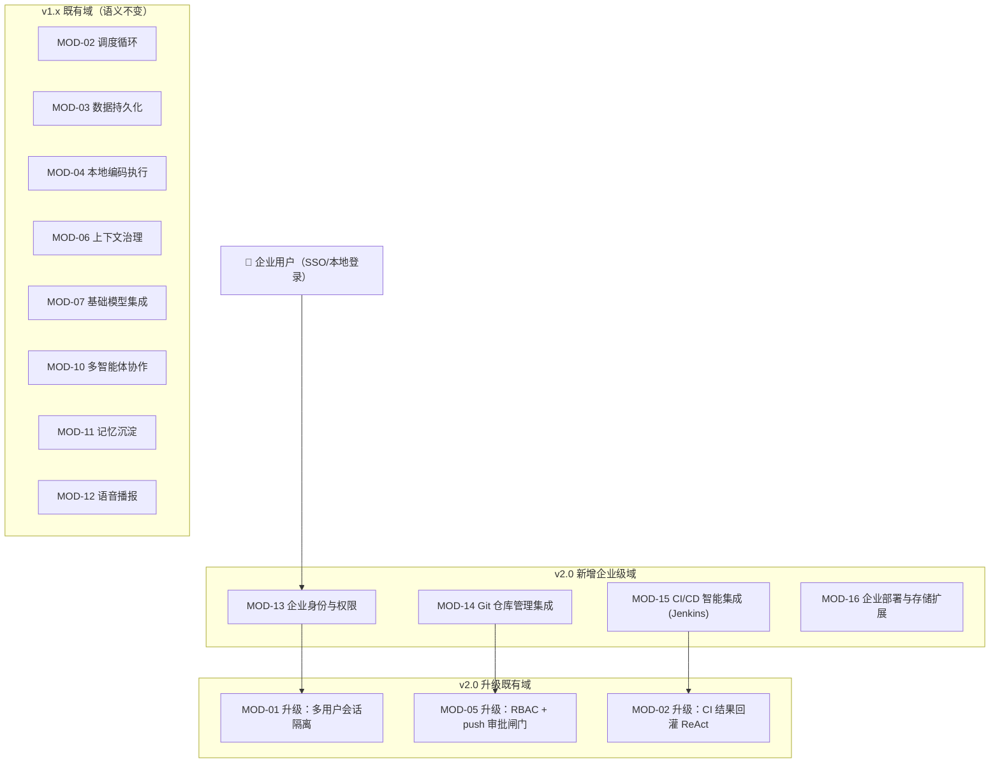

# Purple Grapes Harness v2.0 需求规格说明书 —— 企业级智能体协作平台

> 文档标识：`docs/阶段-1-需求/v2.0-企业级平台需求规格说明书.md`
> 所属阶段：阶段-1-需求
> 版本：v2.0-draft（待评审）
> 目标读者：产品经理、企业架构师、前端/后端工程师、测试工程师、企业客户 IT 决策者
> 前置文档：`docs/阶段-1-需求/功能模块需求规格说明书.md`（v1.0，12 个模块）；`docs/superpowers/specs/2026-10-24-welcome-wizard-v2-design.md` 等 v1.x 增量 spec
> 编写规范：**从企业客户视角出发**，明确系统边界、模块命名、功能编号与业务目的，本版在此基础上细化到数据库 DDL 级别与实现代码。

---

## 0. 文档定位与版本演进

### 0.1 v1.x 现状基线（单机专业版）

PG Harness v1.x 已交付**单机专业版**，包含 12 个功能模块（MOD-01 ~ MOD-12）：

| 模块 | 名称 | v1.x 状态 |
| --- | --- | --- |
| MOD-01 | 会话管理与人机交互 | ✅ 已交付 |
| MOD-02 | 调度循环与执行控制（ReAct + TurnLoop） | ✅ 已交付 |
| MOD-03 | 数据持久化与日志回溯（SQLite 事件溯源） | ✅ 已交付 |
| MOD-04 | 本地编码与核心执行（六工具沙箱） | ✅ 已交付 |
| MOD-05 | 权限防御与安全审计（三档预设 + 硬红线） | ✅ 已交付 |
| MOD-06 | 上下文治理与计量控制（滑动压缩） | ✅ 已交付 |
| MOD-07 | 基础模型与生态集成（OpenAI 兼容协议） | ✅ 已交付 |
| MOD-08 | 服务端通信与网关（SSE + 单实例锁） | ✅ 已交付 |
| MOD-09 | Web 前端工作台 | ✅ 已交付 |
| MOD-10 | 多智能体协作（BPMN 工作流 + 角色流水线） | ✅ 已交付 |
| MOD-11 | 记忆与经验沉淀 | ✅ 已交付 |
| MOD-12 | 语音播报与无障碍 | ✅ 已交付 |

质量基线：43 测试套件 / 404 断言全绿；零 Native 依赖；安全扫描通过；已具备 Docker 化、npx 分发、输入建议、欢迎向导 v2、模型分组选择器、DSH 对齐统计等增量能力。

### 0.2 v2.0 升级动因（企业级差距分析）

v1.x 定位为**单机单用户专业工具**，在以下维度与企业级生产要求存在结构性差距：

| # | 维度 | v1.x 现状 | 企业级要求 | 差距等级 |
| --- | --- | --- | --- | --- |
| G-1 | **用户与身份** | 无用户体系（无 userId），仅单 token 门禁；会话与工作区无归属方 | 多用户注册登录、RBAC 角色权限、SSO 对接企业身份系统 | 🔴 结构性缺失 |
| G-2 | **数据隔离** | 全部数据共享（无 owner），任何持有 token 者可见全部会话 | 会话/工作区/凭据按用户隔离，管理员可按授权范围审计 | 🔴 结构性缺失 |
| **G-3** | **DevOps 集成** | Git 仅本地只读操作（回滚/diff）；push 为硬红线禁止；无 CI/CD 概念 | Git 平台对接（仓库/分支/PR）、推送审批放行、Jenkins 构建触发与结果回灌形成端到端自动化闭环 | 🔴 全新能力域 |
| G-4 | **部署形态** | 单机 127.0.0.1 回环，单实例锁 | 企业内网私有部署 + 云上部署双形态兼容；TLS/反向代理/Docker Compose | 🟡 需补强 |
| G-5 | **存储扩展** | 本机 SQLite 单文件（WAL） | 可插拔存储（PostgreSQL/MySQL 适配器），支持企业级备份恢复策略 | 🟡 需补强 |
| G-6 | **执行沙箱** | 本地目录锁定（路径穿越拦截） | 容器级隔离（Docker 沙箱后端），支持远端 Worker 池扩展 | 🟢 规划项 |
| G-7 | **审计合规** | 事件溯源存于 SQLite 内部 | 审计日志导出、SIEM 对接、合规报表 | 🟢 规划项 |

### 0.3 v2.0 目标定位

**一句话定位**：将 PG Harness 从「单机专业工具」升级为「企业级智能体协作平台」——团队成员在企业身份体系下安全协作，Agent 的编码产出通过 Git 平台与 Jenkins CI/CD 形成端到端自动化闭环，支持企业内网与云上双形态部署。

**核心价值主张（面向企业客户）**：
1. **安全可控**：员工身份经企业 SSO 认证，Agent 操作经 RBAC 授权，高危操作（push/部署）有管理员审批闸门；
2. **端到端自动化**：Agent 修复 bug → 推送分支 → 触发 CI 构建 → 失败日志回灌继续修复——全流程无人值守；
3. **灵活部署**：Docker Compose 一键部署于企业内网或云上，数据不出企业（私有部署模式）；
4. **平滑升级**：v1.x 单机版数据可迁移至 v2.0，已有模块（12 个 MOD）功能语义不变。

### 0.4 范围边界（v2.0 明确不做）

| 排除项 | 理由 |
| --- | --- |
| 计费/订阅系统 | 非本期目标，企业客户以私有部署授权为主 |
| 多租户（租户间完全隔离） | 本期做多用户协作（同一企业内），跨企业多租户列入 v3.0 候选 |
| 移动端 APP | Web 响应式已覆盖核心场景 |
| 自研代码托管平台 | 对接既有平台（GitHub/GitLab/Gitee/自建 Git），不自研 |

---

## 1. 产品总体功能全景（v2.0）

v2.0 在 v1.x 12 个模块基础上**新增 4 个模块**（MOD-13 ~ MOD-16），并升级 3 个既有模块：



### 核心业务闭环（v2.0 旗舰场景）

```
开发者（SSO 登录）→ 指派 bug 修复任务给 Agent
  → Agent 在隔离工作区执行修复（ReAct 循环 + 工具调用）
  → 修复完成 → 创建分支 + 提交 → 【推送审批：组长在平台审批闸门放行】
  → 服务端代为推送到 Git 平台 → 自动创建 Pull Request
  → 触发 Jenkins 构建 → 构建失败？
      ├─ 是 → 失败日志自动回灌 Agent → 继续修复 → 循环直至构建通过
      └─ 否 → 通知开发者：修复完成，PR 待合并
```

---

## 2. 新增模块详细需求

### MOD-13 企业身份与权限模块 (Enterprise Identity & RBAC)

#### 1. 模块定位与业务目标

企业协作的**安全基座**。负责用户注册/登录/身份认证、角色权限控制（RBAC）、SSO 对接适配、操作审计。所有既有模块（会话/工作区/凭据/Pipeline）在该模块之上叠加用户归属与权限过滤。

#### 2. 核心功能清单

**F13.1 用户注册与本地登录**
- **功能描述**：管理员在平台内创建用户（姓名/邮箱/初始密码/角色）；用户首次登录强制修改密码；密码策略可配置（长度/复杂度/有效期）；支持密码重置（管理员重置或邮箱重置链接）；
- **数据模型（DDL 级）**：

```sql
CREATE TABLE users (
  id TEXT PRIMARY KEY,                    -- usr_<uuid>
  username TEXT NOT NULL UNIQUE,          -- 登录名
  display_name TEXT NOT NULL,             -- 显示名
  email TEXT NOT NULL UNIQUE,             -- 邮箱（唯一约束）
  password_hash TEXT NOT NULL,            -- argon2id 哈希
  role TEXT NOT NULL DEFAULT 'member',    -- admin | lead | member
  status TEXT NOT NULL DEFAULT 'active',  -- active | disabled | locked
  created_at INTEGER NOT NULL,
  updated_at INTEGER NOT NULL,
  last_login_at INTEGER,
  password_changed_at INTEGER NOT NULL
);

CREATE TABLE sessions_auth (              -- 认证会话（与业务会话 sessions 区分）
  id TEXT PRIMARY KEY,                    -- authtok_<uuid>
  user_id TEXT NOT NULL REFERENCES users(id),
  token_hash TEXT NOT NULL,               -- 会话 token 哈希（原始 token 不落盘）
  expires_at INTEGER NOT NULL,
  created_at INTEGER NOT NULL,
  ip_address TEXT,
  user_agent TEXT
);
```

- **业务目的**：企业协作的身份入口，密码凭据永不明文存储（argon2id）。

**F13.2 RBAC 角色权限控制**
- **功能描述**：三级内置角色，权限矩阵如下：

| 能力 | admin | lead | member |
| --- | --- | --- | --- |
| 用户管理（创建/禁用/重置密码） | ✅ | ❌ | ❌ |
| 全局设置（Provider 池/系统配置） | ✅ | ❌ | ❌ |
| 查看所有用户的会话（审计） | ✅ | 所辖成员 | ❌ |
| 创建/管理自己的会话与工作区 | ✅ | ✅ | ✅ |
| 绑定 Git 平台凭据 | ✅ | ✅ | ❌（管理员统一配置） |
| Jenkins 任务配置 | ✅ | ✅ | ❌ |
| **推送审批（push gate）放行** | ✅ | ✅ | ❌（发起审批） |
| Jenkins 构建触发 | ✅ | ✅ | ✅（限已授权任务） |
| 修改自己的会话（Abort/回滚） | ✅ | ✅ | ✅ |

- **实现机制**：API 层中间件按 `role + resource.owner_id` 双重判定；数据查询强制注入 `WHERE owner_id = ?`（admin/lead 可查看所辖范围）；前端 UI 按角色显隐入口。
- **业务目的**：最小权限原则，杜绝越权操作；管理员掌握全局审计视图。

**F13.3 SSO 单点登录对接**
- **功能描述**：可插拔 SSO 适配器架构，v2.0 首发支持 **OAuth2/OIDC 通用协议**（覆盖 Azure AD、Google Workspace、Keycloak、Authing 等），并提供 **LDAP/AD** 直连适配器与**飞书/钉钉/企业微信扫码**适配器接口（接口先行，具体平台逐个交付）；
- **适配器接口契约**：

```typescript
interface SsoAdapter {
  /** 协议标识：oidc | ldap | feishu | dingtalk | wecom */
  readonly protocol: string;
  /** 生成授权跳转 URL（OIDC: /authorize；LDAP: null 走直连校验） */
  buildAuthUrl(config: SsoConfig, state: string): string | null;
  /** 用授权码换取身份令牌并拉取用户信息（OIDC flow） */
  exchangeAndFetchProfile(config: SsoConfig, code: string): Promise<SsoProfile>;
  /** LDAP 直连校验（bind + search） */
  ldapBindAndSearch(config: SsoConfig, username: string, password: string): Promise<SsoProfile>;
}
interface SsoProfile {
  externalId: string;      // 企业侧唯一标识
  username: string;        // 登录名映射
  displayName: string;
  email: string;
  roleMapping?: string;    // 企业侧角色 → 本地角色映射建议
}
```

- **账号映射策略**：SSO 首次登录时按 `externalId` 自动创建本地用户（默认 member 角色，管理员可调整），或按邮箱匹配既有本地账号进行绑定；
- **业务目的**：员工使用企业既有账号一键登录，IT 部门统一管控账号生命周期（离职即禁用），杜绝影子账号。

**F13.4 操作审计日志**
- **功能描述**：所有敏感操作（登录/登出/权限变更/审批/push 放行/Jenkins 触发/凭据变更）自动写入审计日志表，记录操作者/IP/时间/操作详情；管理员可按时间/用户/操作类型检索与导出 CSV；
- **数据模型**：

```sql
CREATE TABLE audit_logs (
  id TEXT PRIMARY KEY,
  user_id TEXT,                           -- 操作者（系统操作为 null）
  action TEXT NOT NULL,                   -- login | logout | approval_grant | push_gate_pass | ...
  resource_type TEXT,                     -- session | workspace | provider | jenkins_job | ...
  resource_id TEXT,
  detail_json TEXT,                       -- 操作详情（脱敏后）
  ip_address TEXT,
  created_at INTEGER NOT NULL
);
CREATE INDEX idx_audit_user_time ON audit_logs(user_id, created_at);
CREATE INDEX idx_audit_action_time ON audit_logs(action, created_at);
```

- **业务目的**：满足企业安全合规要求（等保/SOC2），操作可追溯。

---

### MOD-14 Git 仓库管理集成模块 (Git Platform Integration)

#### 1. 模块定位与业务目标

打通 Agent 与企业 Git 平台的**安全通道**。Agent 在隔离工作区完成编码后，通过本模块完成分支管理、提交、**审批放行的推送**与 PR 创建——推送不再是被一刀切禁止的红线，而是「Agent 发起 → 人工审批 → 服务端代为执行」的安全自动化。

#### 2. 核心功能清单

**F14.1 Git 平台连接管理**
- **功能描述**：管理员配置 Git 平台连接（类型：GitHub / GitLab / Gitee / 自建 GitLab CE / 通用 Git HTTP；地址；访问 Token 加密存储——复用 v1.x 凭据加密体系 AES-256-GCM）；连接测试与平台 API 版本探测；
- **数据模型**：

```sql
CREATE TABLE git_connections (
  id TEXT PRIMARY KEY,                    -- gitconn_<uuid>
  name TEXT NOT NULL,
  platform TEXT NOT NULL,                 -- github | gitlab | gitee | gitlab-ce | generic
  base_url TEXT NOT NULL,                 -- API 地址（GitHub: https://api.github.com）
  token_cipher TEXT NOT NULL,             -- 访问 Token（AES-256-GCM 加密）
  default_branch TEXT DEFAULT 'main',
  owner_id TEXT NOT NULL REFERENCES users(id),  -- 配置者
  created_at INTEGER NOT NULL
);
```

- **业务目的**：Agent 知道代码「推到哪里去」，凭据安全托管。

**F14.2 仓库绑定与分支管理**
- **功能描述**：将工作区与 Git 远端仓库绑定（一个工作区绑定一个远端）；平台内查看仓库分支列表、创建特性分支（Agent 修复前自动创建 `agent/fix/<issue-id>` 格式分支）；分支保护规则可配置（如 main 分支禁止 Agent 直接提交）；
- **业务目的**：Agent 的每次修复工作在独立分支上进行，不污染主分支。

**F14.3 提交与推送审批闸门（Push Approval Gate）**
- **功能描述**：
  1. Agent 修复完成后，产出变更文件清单与 diff 摘要，**自动发起推送审批请求**（复用 v1.x 审批卡片 UI）；
  2. 审批人（lead/admin）在平台内查看 diff、填写审批意见；
  3. **审批通过** → 服务端以平台凭据（非 Agent 身份）代为执行 `git push origin <branch>`，推送结果（成功/失败+原因）写回会话；
  4. **审批拒绝** → 拒绝原因回灌 Agent → Agent 可继续修改后重新发起；
  5. 全流程写入审计日志；
- **与 v1.x 红线的关系**：v1.x「Agent 严禁自主 git push」红线**语义不变**（Agent 进程本身仍然无推送能力），只是将「人工在平台外手动 push」升级为「人工在平台内审批后由服务端代为 push」——**安全决策权仍在人，自动化在流程**；
- **业务目的**：堵住「Agent 改完代码还要人手动复制粘贴推送」的断点，同时保证推送经过人工审阅。

**F14.4 Pull Request 创建与状态追踪**
- **功能描述**：推送成功后自动创建 PR（标题/description 由 Agent 生成，包含修复摘要与关联 issue）；平台内查看 PR 状态（open/merged/closed）与 CI 检查结果；支持 PR 评论回读；
- **业务目的**：修复产出以标准 PR 形式进入团队代码评审流程。

**F14.5 多平台适配器架构**
- **接口契约**：

```typescript
interface GitPlatformAdapter {
  readonly platform: string;
  /** 验证连接与凭据 */
  testConnection(conn: GitConnectionConfig): Promise<{ ok: boolean; user: string; permissions: string[] }>;
  /** 列出仓库分支 */
  listBranches(conn: GitConnectionConfig, repo: string): Promise<BranchInfo[]>;
  /** 创建分支 */
  createBranch(conn: GitConnectionConfig, repo: string, branch: string, from: string): Promise<void>;
  /** 创建 PR / Merge Request */
  createPullRequest(conn: GitConnectionConfig, repo: string, pr: PrPayload): Promise<PrInfo>;
  /** 查询 PR 状态与 CI 检查 */
  getPrStatus(conn: GitConnectionConfig, repo: string, prId: number): Promise<PrStatus>;
}
```

- 各平台实现差异（GitHub REST v3 / GitLab REST v4 / Gitee API v5）在适配器内部消化，上层统一调用。

---

### MOD-15 CI/CD 智能集成模块 (Jenkins Integration)

#### 1. 模块定位与业务目标

将 Jenkins 构建纳入 Agent 的感知与行动范围，形成**「修复 → 构建 → 失败回灌 → 再修复」的端到端自动化闭环**——这是 v2.0 的旗舰能力，也是「智能管理」的核心价值。

#### 2. 核心功能清单

**F15.1 Jenkins 连接管理**
- **功能描述**：配置 Jenkins 实例（URL、用户名、API Token 加密存储）；连接测试（获取 crumb CSRF token 验证）；多 Jenkins 实例支持（如开发/测试环境各一套）；
- **数据模型**：

```sql
CREATE TABLE jenkins_connections (
  id TEXT PRIMARY KEY,                    -- jk_<uuid>
  name TEXT NOT NULL,
  base_url TEXT NOT NULL,                 -- Jenkins 地址
  username TEXT NOT NULL,
  api_token_cipher TEXT NOT NULL,         -- API Token（加密）
  owner_id TEXT NOT NULL REFERENCES users(id),
  created_at INTEGER NOT NULL
);
```

**F15.2 任务（Job）发现与绑定**
- **功能描述**：通过 Jenkins REST API 拉取任务列表（`/api/json`），管理员将特定任务绑定到工作区/项目（如 `my-app-ci` 绑定到 `my-app` 工作区）；可配置任务参数化构建的参数模板；
- **业务目的**：Agent 知道「这个项目的构建任务是哪个、怎么触发」。

**F15.3 构建触发与状态追踪**
- **功能描述**：
  1. **手动触发**：平台内一键触发绑定任务的构建（带参数）；
  2. **自动触发**：推送审批通过并成功推送后，自动触发关联构建任务（可配置开关）；
  3. **状态轮询**：构建入队→执行中→完成，实时状态在平台 UI 展示（复用 SSE 推送）；
  4. **结果获取**：构建完成后拉取构建结果（SUCCESS/UNSTABLE/FAILURE）与控制台日志（`/consoleText`）；
- **数据模型**：

```sql
CREATE TABLE jenkins_builds (
  id TEXT PRIMARY KEY,
  connection_id TEXT NOT NULL REFERENCES jenkins_connections(id),
  job_name TEXT NOT NULL,
  build_number INTEGER NOT NULL,
  trigger_source TEXT NOT NULL,           -- manual | auto_after_push
  trigger_user_id TEXT,
  status TEXT NOT NULL,                   -- queued | building | success | unstable | failure | aborted
  duration_ms INTEGER,
  console_log_url TEXT,
  started_at INTEGER,
  finished_at INTEGER
);
```

**F15.4 构建失败智能回灌（旗舰能力）**
- **功能描述**：
  1. 构建失败时，自动截取失败关键段（编译错误/测试失败段落，按 Maven/Gradle/npm/JUnit 输出格式智能提取）；
  2. 失败日志作为「环境观察事实」回灌给 Agent（复用 v1.x 的 untrusted 边界标注机制，S3 原则）；
  3. Agent 基于失败日志继续修复 → 推送 → 再触发构建——**循环直至构建通过或达到重试上限（默认 3 次，可配置）**；
  4. 每轮循环的事件全部落盘，形成完整可追溯的自动化轨迹；
- **回灌格式示例**：

```
<untrusted_ci_result source="jenkins" job="my-app-ci" build="#42" result="FAILURE">
[ERROR] /src/payment.js:15 TypeError: Cannot read property 'fee' of undefined
[ERROR] Tests run: 12, Failures: 2
...
</untrusted_ci_result>
上一轮 Jenkins 构建 #42 失败（这是第 2 次重试，上限 3 次）。请基于以上失败日志继续修复。
```

- **业务目的**：将开发者从「修 bug → 推代码 → 看 CI → 发现又挂 → 拉日志 → 继续修」的机械循环中解放出来。

**F15.5 构建结果通知**
- **功能描述**：构建完成（无论成败）通过平台内通知（SSE 实时推送）与可选 Webhook 外发（对接企业 IM：飞书/钉钉/企微机器人）通知相关人员；
- **业务目的**：构建结果不再需要人盯着 Jenkins 界面等。

---

### MOD-16 企业部署与存储扩展模块 (Enterprise Deployment & Storage)

#### 1. 模块定位与业务目标

让 PG Harness 以**企业级可靠性**运行在企业内网或云上，同时保持「单机专业版」的开箱即用特性。

#### 2. 核心功能清单

**F16.1 Docker Compose 一键部署**
- **功能描述**：提供生产级 `docker-compose.yml`（服务端 + 可选 PostgreSQL + 可选反向代理 Caddy/Traefik），支持环境变量配置（端口/数据目录/TLS/SSO 配置）；提供升级迁移脚本（数据卷保留，平滑升级镜像）；
- **部署形态**：
  - **企业内网**：内网服务器 Docker Compose + 企业 DNS + 内部 TLS 证书；
  - **云上**：云主机 Docker Compose + 公网域名 + Let's Encrypt TLS + 安全组端口白名单；
- **业务目的**：IT 部门半小时内完成生产部署。

**F16.2 存储可插拔架构**
- **功能描述**：抽象存储接口层（`StorageAdapter`），v2.0 交付 **SQLite（默认，单机版）** 与 **PostgreSQL（企业版）** 两个适配器；业务代码通过接口访问，不感知底层实现；PostgreSQL 适配器支持连接池、事务、迁移脚本；
- **选型说明**：单机/小团队（<10 人）SQLite 完全够用（v1.x 已验证）；团队规模增长或需要高可用时切换 PostgreSQL，业务代码零修改；
- **业务目的**：数据层不成为规模化瓶颈，同时避免小团队为不需要的数据库付出运维成本。

**F16.3 v1.x 数据迁移工具**
- **功能描述**：一键将 v1.x 单机版 SQLite 数据（用户默认映射为 admin、会话/事件/工作区/凭据全量迁移）导入 v2.0 环境；迁移前自动备份，支持回滚；
- **业务目的**：老用户平滑升级，数据零丢失。

**F16.4 TLS 与反向代理**
- **功能描述**：内置 HTTPS 支持（证书挂载）与反向代理配置模板（Nginx/Caddy/Traefik 示例，含 WebSocket/SSE 代理配置）；安全响应头（HSTS/CSP/X-Frame-Options）；
- **业务目的**：企业安全基线达标。

**F16.5 健康检查与监控**
- **功能描述**：`/api/health` 增强（组件级健康状态：DB 连接/SSO 连接/Jenkins 连接/Git 连接）；Prometheus `/metrics` 端点（请求延迟/活跃回合/Token 消耗/队列深度）；
- **业务目的**：接入企业监控体系（Grafana/Prometheus 告警）。

---

## 3. 既有模块升级需求（v1.x → v2.0）

### 3.1 MOD-01 升级：多用户会话隔离
- 会话表增加 `owner_id`；所有会话查询按当前用户过滤（admin 可查全部，lead 查所辖）；
- 会话创建时的默认 Provider/模型按用户个人配置（而非全局共享）；
- 工作区增加「团队共享」属性（lead/admin 可将工作区标记为团队共享，成员可选用）。

### 3.2 MOD-05 升级：RBAC + Push Gate
- 权限预设（只读/标准/完全授权）之上叠加 RBAC 角色维度（最终权限 = f(预设, 角色, 资源归属)）；
- `git push` 红线逻辑迁移至 MOD-14 Push Approval Gate（Agent 进程内仍禁止直接 push，语义不变）。

### 3.3 MOD-02 升级：CI 结果回灌
- TurnLoop 的 `drainUserMessages` 机制扩展，支持接收 MOD-15 的构建失败回灌（作为高优先级注入消息）。

---

## 4. 非功能需求

| # | 类别 | 需求 |
| --- | --- | --- |
| N-1 | 性能 | API P95 < 200ms（不含 LLM 调用）；并发 50 用户无降级；SSE 推送延迟 < 500ms |
| N-2 | 安全 | 所有 API 经认证（本地 session token 或 SSO）；凭据 AES-256-GCM 加密；SQL 注入/XSS/CSRF 防护；HTTPS 强制 |
| N-3 | 可用性 | 单实例可用性 99.5%（企业单实例部署 SLA）；数据每日自动备份 |
| N-4 | 兼容 | v1.x 单机版数据可迁移；已有 43 测试套件全量保持通过 |
| N-5 | 浏览器 | Chrome/Edge 最新两个大版本；Firefox ESR |

---

## 5. 交付里程碑建议

| 阶段 | 内容 | 预估规模 |
| --- | --- | --- |
| **Phase 1** | MOD-13 企业身份与权限 + MOD-16 F16.1 Docker 部署 + 数据迁移 | 最大（身份是地基，涉及所有既有表的 owner_id 改造） |
| **Phase 2** | MOD-14 Git 仓库管理集成（含 Push Approval Gate） | 中等 |
| **Phase 3** | MOD-15 Jenkins CI/CD 智能集成（含失败回灌闭环） | 中等 |
| **Phase 4** | MOD-16 F16.2 存储可插拔（PostgreSQL）+ 监控增强 | 视 Phase 1-3 负载决定 |

---

## 6. 开放问题（待评审确认）

| # | 问题 | 影响范围 | 建议 |
| --- | --- | --- | --- |
| Q-1 | SSO 首发优先支持哪个平台？ | MOD-13 F13.3 | 建议先做 OIDC 通用协议（Keycloak 可自建测试），飞书/钉钉按客户需求跟进 |
| Q-2 | Git 平台首发支持哪个？ | MOD-14 | 建议先做 GitLab（企业自建最普遍）+ GitHub（云上通用），Gitee 按需 |
| Q-3 | Jenkins 与 GitLab CI 是否都做？ | MOD-15 | 建议 v2.0 先做 Jenkins（用户明确需求），GitLab CI 列入 v2.1 |
| Q-4 | v1.x 数据迁移是强需求还是可选？ | MOD-16 F16.3 | 取决于现有试用数据的保留意愿，建议保留工具但标记为可选步骤 |
| Q-5 | 是否需要团队消息通知渠道首发？ | MOD-15 F15.5 | 建议先做平台内 SSE 通知，IM webhook 按 IM 类型逐个交付 |
